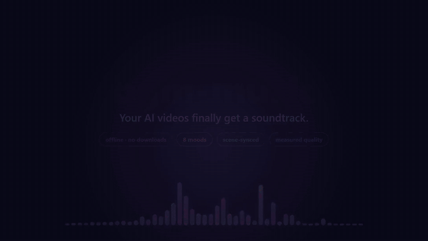

# bgm-music

**Your AI videos finally get a soundtrack.** A Claude Code skill that composes background
music, fits it to your video, checks its own work with measurements, and wires itself into
your other video skills so every video comes out scored.



▶ **[Watch the full 56 s demo with sound](https://github.com/MilkteaTW1/bgm-music-skill/releases/download/v1.0.0/demo.mp4)**
(the soundtrack in it is the skill's own output; the GIF above is a silent preview)

繁體中文說明在[下方](#繁體中文)。

## What it does

- **Offline composer, no downloads**: 8 moods (`uplifting` `corporate` `playful` `lofi`
  `calm` `ambient` `cinematic` `tense`), numpy + ffmpeg only. Seeded and deterministic.
- **Fits the video**: exact length (tempo snaps to whole bars), seamless loops, ring-out
  endings, sections that change on your **scene cuts**.
- **Measures itself**: a 10-criterion evaluator (loudness, headroom, harshness, spectral
  balance, key fit, rhythm, dynamics, variety, stereo, ends) with critical-failure caps.
  Negative controls (noise, clipped sine, random notes, wrong key) must score badly.
- **Mixes for you**: auto-ducks under narration, fades, normalises to -16 LUFS.
- **Improves your other skills automatically**: the installer adds a small, removable
  *Soundtrack* block to every video-related skill (video, Remotion, Hyperframes, ...), and
  the skill's own description triggers on any video task.
- **Optional neural tier**: [ACE-Step 1.5](https://github.com/ACE-Step/ACE-Step-1.5)
  best-of-N wrapper for richer, more "produced" music (asks before any big download).

## Install

Requires Python 3.9+, `numpy`, and `ffmpeg` on PATH.

```bash
git clone https://github.com/MilkteaTW1/bgm-music-skill
cd bgm-music-skill
pip install numpy
python install.py            # install + patch video-related skills
python install.py --no-patch # install only
python install.py --uninstall
```

Patching is conservative: only `SKILL.md` files that mention video tools, one backup per
file (`SKILL.md.bgm-backup`), a clearly delimited block, idempotent, fully reversible.

## Use

Just make a video with Claude Code; the patched skills (and the skill's own trigger) call
the scorer as the last step. Or run it yourself:

```bash
S=~/.claude/skills/bgm-music/scripts

# finished video (+ optional narration) -> scored video
python $S/score_video.py --video out.mp4 --voice narration.wav --brief "SaaS product demo" --out final.mp4

# Remotion / Hyperframes: make the track before rendering
python $S/score_video.py --frames 900 --fps 30 --brief "kids game trailer" --audio-out public/bgm.mp3
#   <Audio src={staticFile('bgm.mp3')} volume={0.35} />

# just a track
python $S/bgm.py --mood lofi --duration 60 --loop --out lofi.mp3
python $S/evaluate.py lofi.mp3 --mood lofi --key D --scale dorian --loop --spectrogram lofi.png
```

`score_video.py` picks the mood from `--brief`, tries several seeds, keeps the best by
evaluator score, and prints a JSON report (exit code 2 if nothing reached 85).

## Honest limits

- Claude cannot hear audio. "Good" means **measured**: key, tempo, loudness, harshness,
  seams. A human listen is still the final judge.
- The procedural tier makes clean, tasteful, generic production music, ideal under voice.
  It will not sound like Suno. Use the ACE-Step tier for richer timbre, then listen.
- On the same brief the evaluator scores procedural higher than ACE-Step (e.g. 99.6 vs
  74-91); that reflects controllability (key, length), not musicality. Details in
  `skills/bgm-music/references/neural-tier.md`.

## Repo layout

```
install.py                  installer / patcher / uninstaller
skills/bgm-music/           the skill (SKILL.md, scripts/, references/)
demo/                       demo.mp4, preview.gif, poster
demo-src/                   Remotion source + make_audio.py that builds the demo
```

Regression bench: `python skills/bgm-music/scripts/bench.py out/` renders every mood and
prints scores (mean 97.7, min 90.7 when this was published).

## License

MIT

---

## 繁體中文

**讓你的 AI 影片終於有配樂。** 這是一個 Claude Code skill：自動作曲、對齊影片長度與場景切換、
用數據自我評估並迭代，並且安裝時會把自己掛進其他影片相關的 skill，讓每支影片產出時都自動配樂。

### 安裝

需要 Python 3.9+、`numpy`、`ffmpeg`。

```bash
git clone https://github.com/MilkteaTW1/bgm-music-skill
cd bgm-music-skill
pip install numpy
python install.py             # 安裝並自動修補影片相關 skill
python install.py --no-patch  # 只安裝
python install.py --uninstall # 完整移除（含修補內容）
```

### 特色
- 離線、不用下載：8 種曲風，純 numpy + ffmpeg。
- 長度精準對齊影片、可無縫循環、段落跟著場景切換點換段。
- 10 項客觀評估（響度、爆音、刺耳度、頻譜、調性、節奏、動態、變化、立體聲、收尾），
  重大缺陷會封頂分數。
- 有旁白時自動壓低音樂、淡入淡出、標準化到 -16 LUFS。
- 選配 ACE-Step 1.5 神經模型（best-of-N），下載前一定會先詢問。

### 重要限制
Claude 聽不到聲音，分數是技術指標而非音樂性判斷；最終請你用耳朵確認。
程式合成的音樂乾淨好用但偏通用，想要更豐富的音色請用 ACE-Step 層並自行試聽。

### 展示影片
[完整影片（含聲音）](https://github.com/MilkteaTW1/bgm-music-skill/releases/download/v1.0.0/demo.mp4)：影片中的配樂就是這個 skill 自己生成的。
